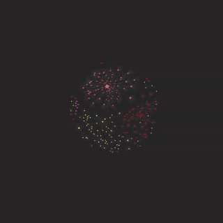

# 🧠 Hal


> *An AI assistant that remembers what you told it last week — and never sends any of it anywhere.*

Hal runs a capable coding and research assistant entirely on your own GPU, and gives it long-term
memory by wiring it into an Obsidian vault. Ask it questions about your own notes and it answers
with citations you can click.



*Every dot is a note, every line a link Hal wrote. This is a few years of course material being
filed, tagged and cross-referenced by `hal summarize`.*

## 🌟 Highlights

- **Nothing leaves your machine.** The model, the embeddings and the search index all run locally.
  The only network traffic is the initial model download.
- **Answers from your own notes**, with `[[wikilink]]` citations back to the source — and it tells
  you when your notes don't cover something instead of inventing an answer.
- **Remembers across sessions.** It writes its own session logs and carries durable facts forward.
- **Lives in your Obsidian vault**, reading and writing notes in the app while it's open.
- **Twelve slash commands** for daily notes, meeting notes, inbox triage, weekly reviews and imports.
- **A morning brief** assembled from your tasks, deadlines and recent work, written into today's note.
- **Works as an MCP server**, so any MCP client can search your vault.

## ℹ️ Overview

Hal can point [Claude Code](https://claude.ai/code) at a local model served by
[Ollama](https://ollama.com) instead of the cloud, then bolts on the pieces that make a local
assistant genuinely useful: a memory system, a semantic index over your notes, and a set of commands
for keeping the vault tidy enough to be worth searching.

The local model is optional. `setup.sh` reads your GPU and picks one of three profiles, so the same
repo works whether you have a 24GB card, a 12GB card, or no GPU at all — see
[Requirements](#requirements). **Searching your notes stays local in every profile**, including
`cloud`: the embedding model is small enough to run on a CPU, so your vault is indexed on your own
machine and only the passages relevant to a question are ever sent anywhere.

The vault is the point. Dump anything into the inbox and Hal files it into a cross-linked, indexed
knowledge base — which then becomes the thing it searches when you ask it something.

| Component | What it does |
|---|---|
| `hal` | Launcher — starts a session in your vault, or in any project with `hal here` |
| `claude-commands/` | The slash commands, installed into `~/.claude/commands/` |
| `vault-index.py` | Builds the semantic index over your notes |
| `ask.py` | Answers questions from the index, with citations |
| `hal-mcp.py` | Serves the same search over MCP |
| `morning-brief.py` | Writes a daily brief into today's note |
| `register-repos.sh` | Adds your local git repos to the vault as summary notes |

### ✍️ Author

Built by [@NotEoin](https://github.com/NotEoin). 

## 🚀 Usage

```bash
hal                  # start a session in your vault
hal here             # start in the current directory, for a coding project
hal ask "..."        # answer a question from your notes, with citations
hal index            # build or refresh the search index
hal brief            # write today's morning brief into your daily note
hal model <name>     # switch to a different Ollama model
hal mode <mode>      # max profile: gpu | cpu | hybrid | hybrid-256k | combined
```

Inside a session, the two commands that matter most day to day:

| Command | When |
|---|---|
| `/load-context` | Start of a session — reloads context from memory and recent logs |
| `/compress` | End of a session — saves what's worth keeping |

Plus `/daily-note`, `/meeting-note`, `/inbox-process`, `/weekly-review`, `/ask`, `/brief`,
`/preserve`, `/import-vault`, `/summarize-slides` and `/index-repos`.

**→ Full reference: [SLASH-COMMANDS.md](SLASH-COMMANDS.md)**

## ⬇️ Installation

```bash
git clone https://github.com/NotEoin/Hal.git
cd Hal
chmod +x setup.sh hal
./setup.sh
```

`setup.sh` reads your GPU, proposes a profile and asks. Then it installs Ollama, pulls whatever that
profile needs, installs Node, Claude Code and `uv`, sets up the slash commands and puts `hal` on your
PATH. It's safe to re-run. Open a new shell afterwards.

```bash
./setup.sh --profile cloud    # force a profile: max | 24gb | 12gb | cloud
./setup.sh --profile 12gb -y  # ...and skip the prompt
```

Your choice is written to `hal.conf`, which the launcher reads. Re-run `setup.sh` to change it.

Then two Obsidian plugins — **Local REST API** and **Dataview** — and hand Hal the API key:

```bash
hal obsidian-key <YOUR_KEY>
```

**→ Full setup walkthrough: [SETUP.md](SETUP.md)**

### Requirements

| | |
|---|---|
| **OS** | Linux |
| **GPU** | Whatever you have — see the profiles below. None is fine |
| **Disk** | ~160GB for the models on `max`, ~20GB on `24gb`, ~8GB on `12gb`, ~300MB on `cloud` |
| **Apps** | [Obsidian](https://obsidian.md) with the Local REST API and Dataview plugins |

#### Setup profiles

| Profile | Picked when | Model | Answers written by |
|---|---|---|---|
| `max` | ≥22GB VRAM and ≥60GB RAM | three models in five modes, up to a 177B (~160GB) | your local models |
| `24gb` | ≥22GB VRAM | Qwen3.8-27B (~18GB) | your local model |
| `12gb` | ≥11GB VRAM | Gemma 4 12B, QAT (~7GB) | your local model |
| `cloud` | no usable GPU | none | Claude Code, with your own login |

The `max` profile serves three models through llama.cpp and lets you pick where they run
per launch: Qwen3.8-27B on the GPU (`gpu`, 80 tokens/s), the 177B Qwen3.8-Flash-Next-Coder
in system RAM (`cpu`), the 177B Qwen3.8-Flash-Next split across both (`hybrid`, 25 tokens/s,
or `hybrid-256k` for its full context), or `combined`, where a small classifier sends each
request to the RAM model or the GPU model and the RAM model delegates its edits to GPU
subagents.
**→ Modes, measurements and quantisation choices: [MODES.md](MODES.md)**

The `24gb` profile runs Qwen3.8-27B, the strongest coding model that fits a 24GB card. The `12gb`
profile runs Gemma 4 12B, which is reliable at tool calling (what Claude Code actually leans on) and
leaves enough VRAM free for [hal-voice](https://github.com/NotEoin/hal-voice) alongside it.

All three profiles pull the ~300MB embedding model, because searching your notes is done locally
regardless. `hal model <name>` switches the language model for a single launch.

Originally built on an RTX 3090; developed since on an RTX 4070.

## 🔒 Privacy

- **The embeddings and the index always run on your machine**, in every profile. Your vault is read,
  chunked and searched locally; there is no hosted retrieval step.
- **On the `24gb` and `12gb` profiles nothing leaves the machine at all** — the model answering you
  is the one on your own GPU.
- **On the `cloud` profile the answer is written by Claude Code**, so the passages retrieved for a
  question are sent to Anthropic along with it. Search stays local; the write-up does not. If that
  matters to you, use a local profile, or `hal ask --no-llm` to see the retrieved passages only.
- Your vault is never uploaded by Hal itself, and is excluded from this repository by `.gitignore`.
- `/index-repos` reads git metadata and README text only. It never reads file contents, and skips
  `.env`, `*.key`, `*.pem`, credentials and anything matching `secrets*`.

## 🧭 Limitations

- **Answers are only as good as your notes.** Retrieval can't rescue a vault full of empty stubs.
- **Importing a large existing vault is slow**, even batched.
- **A local 27B is not a frontier model.** It's very capable at code, search and note-wrangling, and
  it will lose to a cloud model on hard multi-file reasoning.
- Linux only.

## 🔗 Related projects

- **[hal-voice](https://github.com/NotEoin/hal-voice)** — talk to Hal and have it answer aloud in
  HAL 9000's voice.
- **[canvas-downloader](https://github.com/NotEoin/canvas-downloader)** — bulk-import course
  material into the vault.

## 💭 Feedback and contributing

Questions, bugs and ideas welcome — open an [issue](https://github.com/NotEoin/Hal/issues) or start
a [discussion](https://github.com/NotEoin/Hal/discussions).

## 📄 Licence

MIT — see [LICENSE](LICENSE).
