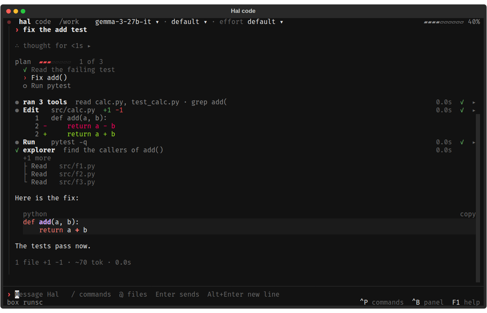
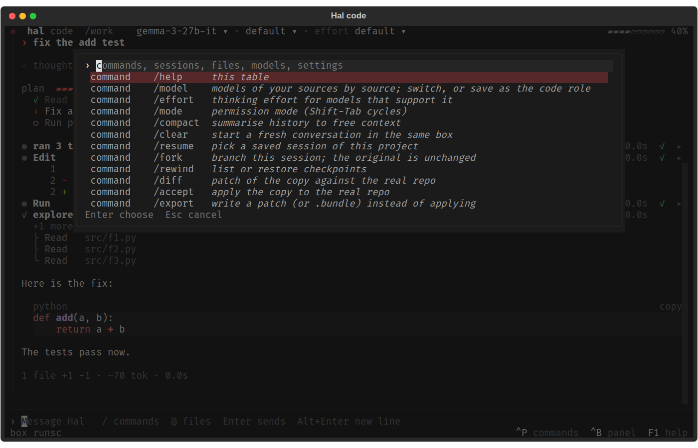
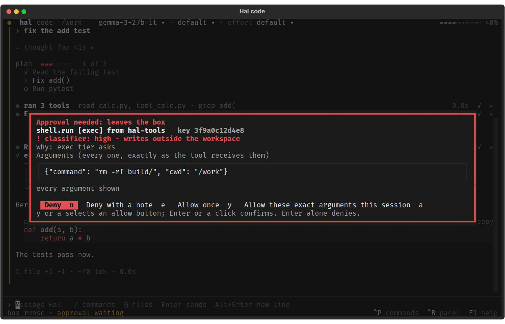
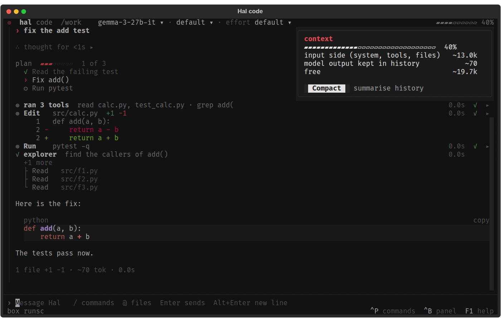

# Hal


> *Make the most of your local models.*

Hal turns the models you already run (Ollama, LM Studio, llama.cpp, GGUF files) into a coding
agent, a chat and a desktop assistant, all on your own machine. It sizes every model to your
hardware, and it never trusts the model: the agent works on a copy of your project, in a box with
no network, and every tool call passes one policy and a local risk classifier.

- **Bring your own models.** Point Hal at Ollama, an OpenAI-compatible server or a folder of GGUF
  files, official releases or community fine-tunes. It downloads nothing.
- **Tuned to your hardware.** `hal tune` picks the context size, cache type, GPU offload and draft
  model for each role, on one GPU, several, or none, and `hal tune --bench` measures the result.
- **A coding agent in a sandbox.** `hal code` edits a copy of your project inside a docker box, and
  you `accept` the changes you want. Switch models and thinking effort mid-session with `/model`
  and `/effort`.
- **One policy for every tool.** Each tool call is checked against your lockdown and paranoia
  levels and rated by a local classifier; the risky ones wait for your approval.
- **No telemetry.** Nothing leaves your machine unless you add a cloud model or a tool that goes
  online.

## Why Hal

### Local AI is min-maxing

Running models locally means trading quality, speed and memory against each other on the hardware
you have. Official releases come in a few sizes, tuned to be good at everything, and they refuse
some tasks outright. Community weights fill the gaps: quantisations sized to your card, coding and
writing fine-tunes, models with an MTP head for faster decoding, and "abliterated" models with
their refusals removed. For many people they are the best results their hardware can give.

### Community weights carry real risk

Open models are now very capable, and safety training is a thin layer over that capability:

- **Refusals come off easily.** Refusal in many open models is carried by a single direction in
  the model's activations; remove it and the model stops refusing, with little loss elsewhere
  [[1]](#references). This is how abliterated models are made, and it also removes the model's
  habit of steering away from harmful output. Much of safety training changes only the first few
  tokens of an answer [[2]](#references).
- **Fine-tuning erodes guardrails, even by accident.** Ten harmful examples undid GPT-3.5 Turbo's
  safety training, and fine-tuning on ordinary, benign data also weakened it [[3]](#references).
  Training a model on one narrow task (writing insecure code without saying so) made it broadly
  misaligned on unrelated questions [[4]](#references). Large labs test their data and models
  across many edge cases; someone fine-tuning a model for their own use usually does not.
- **Backdoors survive safety training.** A model can be trained to behave well until a trigger
  appears, then act maliciously, and standard safety training does not remove it
  [[5]](#references). Poisoning needs very little data: 250 documents backdoored models from 600M
  to 13B parameters [[6]](#references). A harmful fine-tune can be hidden in data that looks
  innocent, every example harmless on its own [[7]](#references).
- **The file itself can attack you.** A GGUF carries a chat template, a small program that runs on
  every request; a poisoned one implants a backdoor without touching the weights, and passed the
  automated scans of the largest model hub [[8]](#references). Over 100 models with code-execution
  payloads were found on Hugging Face in 2024 [[9]](#references).

A model that behaves well 99% of the time can still do harm the other 1%, and you cannot test
your way to knowing which kind you downloaded.

### Approval prompts do not scale

Most agent harnesses guard the machine with a permission list: some commands run, others prompt.
The lists are easy to get around (Roo Code's command allowlist had several bypasses through
shell substitution [[10]](#references)), and they stop harmless calls too, so the person
approving gives up reading. Claude Code users approved 93% of permission prompts
[[11]](#references), and Anthropic introduced sandboxing partly because constant approvals lead
to "approval fatigue" [[12]](#references). A person who cannot read shell will not judge a
command, and a person who can will stop after the hundredth prompt of a long task. Either way
the agent ends up with your whole home directory.

### Hal's answer: contain the agent

Hal assumes the model is hostile and makes the worst case small:

- The agent works on a copy of your project, in a docker box (gVisor when installed) with no
  network. Its only ways out are the tool broker and the model socket.
- Every tool call goes through one broker (MCP), with tight scopes and one approval policy.
  An approval is bound to the exact arguments you saw, and the model cannot approve itself.
- A local classifier (IBM Granite Guardian) rates every call and can only make the decision
  stricter, so safe calls need no prompt and risky ones stop or ask.
- Changes reach your real project only when you `accept` them, with a diff and a checkpoint.

With the default settings, the worst a compromised model can do is spoil its copy of your work;
the [security guide](docs/user/security.md) lists what is not contained, such as host MCP
servers you add. That leaves room to try fine-tuned and abliterated models, let the agent near
sensitive projects, and run long coding tasks unattended.

## Screenshots

| | |
| --- | --- |
|  |  |
| A turn: the plan, folded tool rows, an inline diff and a code block with `copy` | Ctrl+P: one search over commands, sessions, files, models and settings |
|  |  |
| An approval: every argument shown, Deny focused, allowing takes two steps | A click on the context gauge: what fills the window, and Compact |

The [terminal UI tour](docs/user/hal-code.md) covers every key and menu.

## Requirements

| | |
| --- | --- |
| OS | Linux with systemd, or Windows 11 through WSL2 ([how-to](docs/howto/run-on-windows-with-wsl2.md)) |
| Python | 3.11 or later, and [uv](https://docs.astral.sh/uv/) |
| Docker | Needed for `hal code` and `hal chat`, which run the agent in a box. gVisor (`runsc`) is optional |
| GPU | Any, or none. `hal tune` sizes the models to what it finds |
| Models | Ones you already have. Hal downloads none |

## Install

```sh
git clone https://github.com/NotEoin/Hal.git && cd Hal
scripts/install.sh --dry-run   # print every step, change nothing
scripts/install.sh             # private venv in ~/.local/share/hal, link in ~/.local/bin
hal setup --dry-run            # plan the rest: packs, box image, units, doctor
hal setup                      # run it; add --enable to start the units at login
```

The full walk-through, with options and checks, is in [SETUP.md](SETUP.md).

## Point Hal at your models

```sh
hal models add-source ollama http://127.0.0.1:11434   # or: hal models add-source gguf ~/models
hal tune --auto                                       # show the plan, change nothing
hal tune --auto --write                               # pin the models and save the settings
```

See [Point Hal at your models](docs/howto/point-hal-at-your-models.md) and
[Models](docs/user/models.md).

## Main commands

| Command | What it does |
| --- | --- |
| `hal code [DIR]` | Coding session in a box, on a copy of the project. `hal code accept SID` applies its changes |
| `hal chat [MESSAGE]` | Talk to Hal in a box |
| `hal tune` | Detect hardware and plan model settings; interactive on a terminal, `--write` saves |
| `hal models` | List sources and models, add or remove a source, assign a role |
| `hal setup` | Finish an install: packs, gpu-light, box image, units, doctor |
| `hal doctor` | Read-only health report; exits 1 on a failed check |
| `hal on` / `hal off` | Start the services, or stop those using the GPU and free it |
| `hal lockdown`, `hal paranoia`, `hal policy` | Show the security levels and the approval policy |

`hal --help` lists every command, and `hal help COMMAND` shows one command's options.
Reference: [docs/user/cli.md](docs/user/cli.md).

## How it fits together

Hal is the core: the gateway that serves your models, the hub that runs every tool under one
approval policy, and the sandbox the agent works in. The other repos plug into it. Each one also
works on its own, so you install only what you want. Together they make one modular assistant that
writes code, keeps your calendar, remembers what you tell it, answers out loud, and shares your GPU
with everything else you run. Nothing leaves your machine unless you add a cloud model or turn on a
tool that goes online, and every tool call passes the same policy.

| Repo | What it gives you |
| --- | --- |
| [Hal](https://github.com/NotEoin/Hal) | The core: your models, a sandboxed coding agent and chat, the tool hub and the security policy |
| [hal-tools](https://github.com/NotEoin/hal-tools) | A desktop assistant: calendar, tasks, mail, messages, web, desktop and system control |
| [hal-memory](https://github.com/NotEoin/hal-memory) | A memory in an Obsidian vault, so small models answer from your notes, with citations |
| [hal-voice](https://github.com/NotEoin/hal-voice) | Speech in and out, in the voice of HAL 9000 |
| [gpu-light](https://github.com/NotEoin/gpu-light) | Keeps your assistant ready without taking the GPU from your games, renders and training |
| [hal-employment](https://github.com/NotEoin/hal-employment) | Finds jobs, writes the CV and cover letter and fills in the form; you press Submit |

`hal setup` installs the ones it finds next to this checkout.

## Security

Hal treats its own model as hostile: a model changed to cause damage is contained by the default
settings. Every Hal agent turn runs in a box with no network and no access to your files except a
copy of the project and a scratchpad. The full guide, with the paths that are *not* private, is
[docs/user/security.md](docs/user/security.md).

| Risk | What stops it |
| --- | --- |
| A tool call that deletes, sends or runs something you did not ask for | Tool tiers and the policy: `act`, `send` and `system` tools ask first, and an approval is bound to the exact arguments you saw |
| The model approving itself | An approval is a structured answer from a surface (terminal, phone, editor), never text the model wrote; a tool call cannot carry one |
| Instructions hidden in a web page, file or tool result | Results of untrusted tools come back in a marked envelope, and the session's taint raises what needs approval |
| The agent reading your home directory or secrets | The agent runs in a box with a copy of the project at `/work` and a scratchpad at `/scratch`; nothing else of the host is mounted |
| The agent reaching the network | The box has no network; its only channels out are the tool broker and the model socket |
| The agent changing your real repository | Changes leave the box only through `hal code accept` (diff report, flags, checkpoint) or `hal code export` |
| A risky call that policy allows | The risk classifier rates every boxed call and can only make the decision stricter (see below) |
| Changing its own limits | Lockdown and paranoia are read from host files and the host environment; no tool argument or box setting can change them |

Two settings are yours alone; no tool call can change either. `hal status` and `hal doctor` show them.

**Lockdown** (`[sandbox].lockdown`):

| Level | Meaning |
| --- | --- |
| `strict` | runsc (gVisor) required, Hal refuses to start without it; isolated copy only; resource limits; no host tool upstreams except `hal-hub`; paranoia floor `high` |
| `standard` (default) | runsc when installed, else runc with a doctor warning; isolated copy by default; limits on; host upstreams allowed by policy |
| `relaxed` | also allows `--direct` (the real project mounted read-write) and the dependency-install box with network |
| `off` | allows running without a box after a per-project consent; `hal doctor` reports a problem on every run; never a default |

**Paranoia** (`[policy].paranoia`): how strictly a local classifier rates each call.

| Paranoia | low risk | medium | high | critical |
| --- | --- | --- | --- | --- |
| `off` | policy | policy | policy | policy |
| `low` | policy (+review) | policy | ask | ask |
| `balanced` (default) | policy (+review) | ask | ask | deny |
| `high` | policy | ask | deny | deny |
| `max` | ask | ask | deny | deny |

## How Hal compares

The most used harnesses that run local models, by GitHub stars on 2026-11-11, and what their own
documentation says about where commands run and who decides:

| Harness | Stars | Where the agent's commands run | Who decides what runs |
| --- | --- | --- | --- |
| [OpenCode](https://opencode.ai/docs/permissions/) | 226k | On the host, with the user's file, process and network rights | Rules (`allow`, `ask`, `deny`); everything is allowed by default except reading `.env` |
| [Codex CLI](https://learn.chatgpt.com/docs/llms-full.txt) | 135k | An OS sandbox (bubblewrap and seccomp on Linux): writes in the workspace, network off | Approval on request; an optional reviewer agent (`approvals_reviewer = "auto_review"`) |
| [OpenHands](https://docs.openhands.dev/sdk/guides/security) | 93k | A docker container | Confirmation off by default; the default analyzer uses risk labels the agent's own model assigns |
| [Cline](https://docs.cline.bot/features/auto-approve) | 72k | On the host | Prompts, auto-approve per category, YOLO mode; the model itself flags which commands need approval |
| [Open Interpreter](https://docs.openinterpreter.com/safety/introduction) | 69k | On the host | Asks before running code; `-y` runs everything; code scanning is experimental |
| [Goose](https://goose-docs.ai/docs/guides/goose-permissions) | 56k | On the host | Modes from ask to autonomous; an opt-in reviewer model that lets a call through when it fails [[13]](#references) |
| [Aider](https://aider.chat/docs/config/options.html) | 50k | On the host | Suggests shell commands and asks before each; `--yes-always` says yes to every confirmation |
| [Continue](https://docs.continue.dev/cli/tool-permissions) | 36k | On the host | Per-tool policies: ask or automatic |
| [Qwen Code](https://qwenlm.github.io/qwen-code-docs/en/users/features/sandbox) | 29k | On the host; docker, podman or Seatbelt when enabled, and in YOLO mode | Approval modes |
| **Hal** | | A docker box (gVisor when installed) on a copy of the project, no network | One broker and policy for every tool, a local classifier on every call, approvals bound to the arguments |

Codex CLI and OpenHands also contain the agent, and Claude Code, a cloud product, now runs every
action past a classifier by default on its paid plans [[14]](#references). Hal's difference is
doing all of it at once with local models: the copy, the box with no network, one broker for
every tool, and a classifier that runs on your own machine and is on from the first run.

## No telemetry

No Hal package sends usage data, crash reports or update checks. `tests/test_no_telemetry.py`
fails when a module opens a network client outside a short reviewed list.

## Run the tests

```sh
uv sync --all-packages
uv run pytest -q              # hermetic; gpu, docker, network and live tests are deselected
uv run ruff check .
scripts/check-ascii.sh
```

## Documentation

[docs/README.md](docs/README.md) indexes every guide, how-to and design spec.

## Contributing

Read [CONTRIBUTING.md](CONTRIBUTING.md) and [AGENTS.md](AGENTS.md). Report vulnerabilities as
described in [SECURITY.md](SECURITY.md).

## References

1. Arditi et al., "Refusal in Language Models Is Mediated by a Single Direction", NeurIPS 2024. [arXiv:2406.11717](https://arxiv.org/abs/2406.11717)
2. Qi et al., "Safety Alignment Should Be Made More Than Just a Few Tokens Deep", ICLR 2025. [arXiv:2406.05946](https://arxiv.org/abs/2406.05946)
3. Qi et al., "Fine-tuning Aligned Language Models Compromises Safety, Even When Users Do Not Intend To!", ICLR 2024. [arXiv:2310.03693](https://arxiv.org/abs/2310.03693)
4. Betley et al., "Emergent Misalignment: Narrow finetuning can produce broadly misaligned LLMs", ICML 2025. [arXiv:2502.17424](https://arxiv.org/abs/2502.17424)
5. Hubinger et al., "Sleeper Agents: Training Deceptive LLMs that Persist Through Safety Training", 2024. [arXiv:2401.05566](https://arxiv.org/abs/2401.05566)
6. Anthropic, UK AI Security Institute and the Alan Turing Institute, "A small number of samples can poison LLMs of any size", October 2025. [anthropic.com](https://www.anthropic.com/research/small-samples-poison)
7. Halawi et al., "Covert Malicious Finetuning: Challenges in Safeguarding LLM Adaptation", ICML 2024. [arXiv:2406.20053](https://arxiv.org/abs/2406.20053)
8. Pillar Security, "LLM Backdoors at the Inference Level: The Threat of Poisoned Templates", 2025 ([pillar.security](https://www.pillar.security/blog/llm-backdoors-at-the-inference-level-the-threat-of-poisoned-templates)), and "Inference-Time Backdoors via Chat Templates: From LLM Supply Chains to Agentic System Compromise", 2026 ([arXiv:2602.04653](https://arxiv.org/abs/2602.04653))
9. JFrog, "Data Scientists Targeted by Malicious Hugging Face ML Models with Silent Backdoor", February 2024. [jfrog.com](https://jfrog.com/blog/data-scientists-targeted-by-malicious-hugging-face-ml-models-with-silent-backdoor/)
10. VulnCheck, "Roo Code through 3.54.0 auto-approve bypass via command substitution at command position", 2026. [vulncheck.com](https://www.vulncheck.com/advisories/roo-code-through-3.54.0-auto-approve-bypass-via-command-substitution-at-command-position)
11. Anthropic, "How we built Claude Code auto mode", March 25, 2026. [anthropic.com](https://www.anthropic.com/engineering/claude-code-auto-mode)
12. Anthropic, "Making Claude Code safer with sandboxing", October 20, 2025. [anthropic.com](https://www.anthropic.com/engineering/claude-code-sandboxing)
13. goose, "Adversary mode", March 31, 2026. [goose-docs.ai](https://goose-docs.ai/blog/2026/03/31/adversary-mode)
14. Anthropic, "Auto mode is now the default in Claude Code for Pro, Max, and Team plans", August 7, 2026. [claude.com](https://claude.com/blog/auto-mode-default-in-claude-code)

## Licence

MIT, see [LICENSE](LICENSE).
